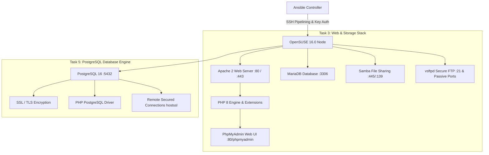

# Ansible Server Automation: OpenSUSE 16.0 Enterprise Infrastructure

[](https://www.ansible.com/)
[](https://www.opensuse.org/)
[](LICENSE)

An enterprise-grade, role-based Ansible automation suite designed to deploy, configure, and secure infrastructure services on **OpenSUSE 16.0**.

---

## 📌 Features & Architecture Overview

This project implements **Task 3** and **Task 5** of the DevOps Server Automation assignment:



### 🎯 Key Highlights:
1. **Target Operating System**: Built strictly for **OpenSUSE 16.0 / Leap**, leveraging native `zypper` packaging, `firewalld` integration, and SUSE service conventions (`apache2`, `smb`/`nmb`, `mariadb`, `postgresql`).
2. **Modular Ansible Roles**: Clear separation of concerns with isolated tasks, handlers, default variables, and Jinja2 templates.
3. **Enhanced Security**:
   - **Zero Plaintext Passwords** in inventory.
   - Ready for **Ansible Vault** encryption (`vault.yml`).
   - PostgreSQL remote access strictly guarded by **SSL encryption (`hostssl`)** and SCRAM-SHA-256.
   - Samba shared folder isolated with user authentication and custom `create mask` / `directory mask`.
   - FTP isolated inside a secure chroot environment.
4. **Optimized Execution Speed**:
   - `pipelining = True` eliminates redundant SFTP transfers.
   - SSH `ControlMaster` and `ControlPersist=600s` reuses existing SSH sessions.
   - Smart fact caching (`fact_caching = jsonfile`).
   - Increased worker parallelism (`forks = 10`).

---

## 📂 Project Directory Structure

```text
ansible-server-automation/
├── ansible.cfg                      # Tuned configuration (pipelining, forks, fact caching)
├── inventory/
│   ├── hosts.ini                    # Secure inventory without plaintext credentials
│   └── group_vars/
│       └── all/
│           ├── vars.yml             # Global parameters and service configurations
│           ├── vault.yml            # Sensitive passwords (encrypted via ansible-vault)
│           └── vault_example.yml    # Plaintext reference template
├── site.yml                         # Master orchestration playbook
├── playbooks/
│   ├── lamp.yml                     # Dedicated LAMP & PhpMyAdmin playbook
│   ├── samba.yml                    # Dedicated Samba sharing playbook
│   ├── ftp.yml                      # Dedicated vsftpd FTP playbook
│   └── postgresql.yml               # Dedicated PostgreSQL SSL playbook
├── roles/
│   ├── common/                      # Zypper cache refresh, firewalld, base packages
│   ├── apache/                      # Apache2 installation, vhost template, status page
│   ├── php/                         # PHP 8 runtime and core extensions
│   ├── phpmyadmin/                  # PhpMyAdmin deployment, config.inc.php, Apache alias
│   ├── mariadb/                     # MariaDB hardening, database & user initialization
│   ├── samba/                       # System user, Samba user, directory & smb.conf template
│   ├── ftp/                         # vsftpd server, user creation, chroot, vsftpd.conf template
│   └── postgresql/                  # PostgreSQL 16, SSL certificate generation, remote access
├── scripts/
│   ├── setup_vault.sh               # Quick helper to encrypt/decrypt vault credentials
│   └── run_playbook.sh              # Interactive execution wrapper
├── team_list.txt                    # Academic team members submission document
├── README.txt                       # Submission text file with GitHub link and execution steps
└── README.md                        # Documentation
```

---

## 🚀 Quick Start Guide

### 1. Prerequisites on Controller Node
Ensure Ansible and required collections are installed on your machine:
```bash
ansible-galaxy collection install community.general community.mysql community.postgresql ansible.posix
```

### 2. Configure SSH Access to OpenSUSE
Copy your SSH public key to the OpenSUSE server so that passwords are never transmitted in cleartext:
```bash
ssh-copy-id root@<OPENSUSE_IP>
```

Update `inventory/hosts.ini` with your server IP:
```ini
[opensuse_servers]
opensuse-node01 ansible_host=192.168.1.100 ansible_user=root ansible_ssh_private_key_file=~/.ssh/id_rsa
```

### 3. Encrypt Sensitive Credentials (Ansible Vault)
Protect all database and service passwords using Ansible Vault:
```bash
ansible-vault encrypt inventory/group_vars/all/vault.yml
```
*(Enter a vault password when prompted).*

### 4. Verify Connectivity
Test the connection and verify that Ansible communicates with OpenSUSE:
```bash
ansible -i inventory/hosts.ini opensuse_servers -m ping
```

### 5. Execute Full Deployment
Run the complete automation suite:
```bash
ansible-playbook -i inventory/hosts.ini site.yml --ask-vault-pass
```

---

## 🛠️ Individual Playbook Execution

If you only need to run specific components, use the modular playbooks in `playbooks/`:

| Component | Command | Description |
|---|---|---|
| **LAMP Stack** | `ansible-playbook -i inventory/hosts.ini playbooks/lamp.yml` | Deploys Apache, PHP 8, MariaDB & PhpMyAdmin |
| **Samba Share** | `ansible-playbook -i inventory/hosts.ini playbooks/samba.yml` | Creates user, share directory with `create mask` |
| **Secure FTP** | `ansible-playbook -i inventory/hosts.ini playbooks/ftp.yml` | Configures vsftpd with isolated user chroot |
| **PostgreSQL** | `ansible-playbook -i inventory/hosts.ini playbooks/postgresql.yml` | Installs Postgres, sets SSL certs, enables remote access |

---

## 🔒 Verification & Testing Guide

Once the playbook completes, verify each service on OpenSUSE:

### 1. LAMP & PhpMyAdmin
- Open `http://<OPENSUSE_IP>/` to view the automated landing page.
- Open `http://<OPENSUSE_IP>/info.php` to verify PHP 8 and PostgreSQL modules.
- Open `http://<OPENSUSE_IP>/phpmyadmin` to log into MariaDB.

### 2. Samba File Share
From Linux or Windows:
```bash
smbclient //<OPENSUSE_IP>/OpenSuseShare -U sambauser
```
*(Enter the `samba_user_password` configured in `vault.yml`)*.

### 3. FTP Service (vsftpd)
```bash
ftp <OPENSUSE_IP>
# Enter username: ftpuser
# Enter password from vault.yml
```

### 4. PostgreSQL SSL Remote Connection
Verify that PostgreSQL accepts remote encrypted connections:
```bash
psql "sslmode=require host=<OPENSUSE_IP> port=5432 dbname=production_db user=dbadmin"
```

---

## 👥 Authors & Team
- **GitHub Repository**: [https://github.com/isra-jq/ansible-server-automation](https://github.com/isra-jq/ansible-server-automation)
- **Collaborator**: `gcussi@yahoo.com`
- Refer to [team_list.txt](file:///home/isra/.gemini/antigravity-ide/scratch/ansible-server-automation/team_list.txt) for student details.
