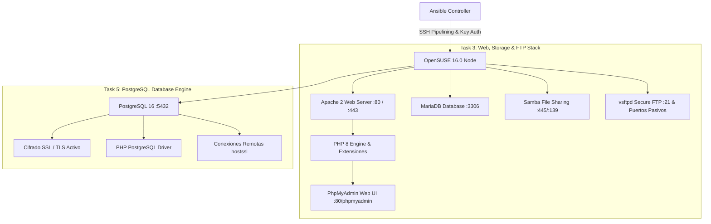

# Ansible Server Automation: OpenSUSE 16.0 Enterprise Infrastructure

[](https://www.ansible.com/)
[](https://www.opensuse.org/)
[](LICENSE)

Automatización integral de infraestructura basada en **Roles de Ansible** para el aprovisionamiento, configuración y aseguramiento de servicios empresariales sobre **OpenSUSE 16.0**.

---

## 📌 Arquitectura del Proyecto

Este repositorio implementa la automatización requerida para **Task 3** y **Task 5**:



### 🎯 Puntos Clave de la Implementación:
1. **Sistema Operativo Objetivo**: Específico para **OpenSUSE 16.0 / Leap**, utilizando el gestor de paquetes nativo `zypper`, integración con `firewalld` y servicios del sistema (`apache2`, `smb`/`nmb`, `mariadb`, `postgresql`, `vsftpd`).
2. **Arquitectura de Roles**: Modularización completa en `roles/` con tareas, manejadores (`handlers`), variables por defecto y plantillas Jinja2 (`templates`).
3. **Seguridad Avanzada**:
   - **Cero contraseñas en texto plano** en el inventario. Autenticación mediante claves SSH.
   - Credenciales protegidas mediante **Ansible Vault** (`vault.yml`).
   - Acceso remoto a PostgreSQL estrictamente blindado con **cifrado SSL (`hostssl`)**.
   - Carpeta compartida de Samba aislada con usuario del sistema, usuario Samba y directivas `create mask = 0775` y `directory mask = 0775`.
   - FTP configurado en entorno enjaulado (`chroot`) para máxima seguridad.
4. **Optimización del Tiempo de Respuesta ("Improve time response")**:
   - `pipelining = True`: Ejecución en memoria sin transferencias redundantes por SFTP.
   - `ControlMaster=auto` y `ControlPersist=600s`: Reutilización de conexiones SSH existentes durante 10 minutos.
   - `gathering = smart` con caché de facts (`fact_caching = jsonfile`).
   - `forks = 10`: Paralelismo concurrente de 10 hilos.

---

## 📂 Estructura de Directorios

```text
ansible-server-automation/
├── ansible.cfg                      # Configuración de rendimiento (pipelining, forks, fact caching)
├── inventory/
│   ├── hosts.ini                    # Inventario seguro sin contraseñas visibles
│   └── group_vars/
│       └── all/
│           ├── vars.yml             # Variables generales de OpenSUSE 16.0
│           ├── vault.yml            # Contraseñas protegidas para Ansible Vault
│           └── vault_example.yml    # Plantilla de referencia no cifrada
├── site.yml                         # Playbook maestro de orquestación
├── playbooks/
│   ├── lamp.yml                     # Playbook modular LAMP + PhpMyAdmin
│   ├── samba.yml                    # Playbook modular Samba
│   ├── ftp.yml                      # Playbook modular vsftpd
│   └── postgresql.yml               # Playbook modular PostgreSQL (Task 5)
├── roles/
│   ├── common/                      # Refresco de zypper, paquetes esenciales y firewalld
│   ├── apache/                      # Servidor Apache2, módulos, virtualhost y landing page
│   ├── php/                         # PHP 8 runtime y extensiones requeridas
│   ├── phpmyadmin/                  # Despliegue de PhpMyAdmin y alias de Apache
│   ├── mariadb/                     # MariaDB hardening, base de datos y usuario de app
│   ├── samba/                       # Usuarios, directorio y smb.conf con create mask
│   ├── ftp/                         # vsftpd server, usuario enjaulado y vsftpd.conf
│   └── postgresql/                  # PostgreSQL 16, generación de certificados SSL y hostssl
├── scripts/
│   ├── run_playbook.sh              # Menú interactivo para lanzar la automatización
│   ├── setup_vault.sh               # Asistente para cifrar/descifrar credenciales de Vault
│   ├── push_to_github.sh            # Script de sincronización con GitHub
│   └── package_submission.sh        # Generador de archivos .zip y .tar.gz para entrega
├── team_list.txt                    # Formato oficial de integrantes del equipo
├── README.txt                       # Archivo de texto plano para entrega académica
└── README.md                        # Documentación técnica completa
```

---

## 🚀 GUÍA DE LANZAMIENTO Y DESPLIEGUE PASO A PASO

Sigue esta guía detallada para ejecutar y validar la automatización en cualquier servidor OpenSUSE 16.0:

### Paso 1: Prerrequisitos en la Máquina de Control (Tu PC / Laptop)
Asegúrate de tener instaladas las colecciones necesarias de Ansible:
```bash
ansible-galaxy collection install community.general community.mysql community.postgresql ansible.posix
```

### Paso 2: Configurar la IP del Servidor OpenSUSE
Abre el archivo de inventario:
```bash
nano inventory/hosts.ini
```
Modifica la línea de `opensuse-node01` con la dirección IP de tu servidor:
```ini
[opensuse_servers]
opensuse-node01 ansible_host=192.168.1.100 ansible_user=root ansible_ssh_private_key_file=~/.ssh/id_rsa
```

### Paso 3: Copiar tu Clave SSH al Servidor (Sin contraseñas visibles)
Para cumplir con la directiva de seguridad, transfiere tu clave pública SSH a OpenSUSE:
```bash
# Si aún no tienes clave SSH en tu máquina:
ssh-keygen -t rsa -b 4096 -N "" -f ~/.ssh/id_rsa

# Copiar clave pública a OpenSUSE (reemplaza por la IP de tu servidor):
ssh-copy-id root@192.168.1.100
```

### Paso 4: Probar Conexión (Ping de Ansible)
Verifica que Ansible se comunica fluidamente con OpenSUSE:
```bash
ansible -i inventory/hosts.ini opensuse_servers -m ping
```
*Deberás ver una respuesta exitosa con `"ping": "pong"`.*

---

### Paso 5: Lanzar la Automatización

Dispones de tres modalidades para realizar el lanzamiento:

#### Modalidad A: Menú Interactivo de Lanzamiento (Recomendado)
Ejecuta el script interactivo que te guiará con un menú:
```bash
./scripts/run_playbook.sh
```
Opciones disponibles en el menú:
1. `1) Run FULL Infrastructure Deployment (site.yml)`: Despliega todo el servidor.
2. `2) Run LAMP Stack Only`: Despliega Apache, PHP, MariaDB y PhpMyAdmin.
3. `3) Run Samba Sharing Only`: Despliega solo el servicio Samba.
4. `4) Run vsftpd Secure FTP Only`: Despliega solo el servidor FTP.
5. `5) Run PostgreSQL Role Only`: Despliega PostgreSQL con soporte SSL y PHP.
6. `6) Test Ping Connectivity`: Realiza un test de conexión.

#### Modalidad B: Lanzamiento Directo por Consola
Para lanzar la infraestructura completa de una sola vez:
```bash
ansible-playbook -i inventory/hosts.ini site.yml
```

*Si decides cifrar tu `vault.yml` con contraseña maestra:*
```bash
ansible-playbook -i inventory/hosts.ini site.yml --ask-vault-pass
```

#### Modalidad C: Lanzamiento Modular por Tareas Específicas
Si necesitas ejecutar únicamente una tarea en particular:
```bash
# Desplegar únicamente LAMP y PhpMyAdmin
ansible-playbook -i inventory/hosts.ini playbooks/lamp.yml

# Desplegar únicamente Samba
ansible-playbook -i inventory/hosts.ini playbooks/samba.yml

# Desplegar únicamente FTP
ansible-playbook -i inventory/hosts.ini playbooks/ftp.yml

# Desplegar únicamente PostgreSQL con SSL (Task 5)
ansible-playbook -i inventory/hosts.ini playbooks/postgresql.yml
```

---

## 🔍 Verificación de los Servicios Desplegados

Una vez completado el despliegue, valida el correcto funcionamiento de cada servicio:

### 1. Servidor Web Apache & PHP
- Abre en tu navegador: `http://<OPENSUSE_IP>/`  
  *(Verás la landing page con el panel de estado de los servicios).*
- Abre en tu navegador: `http://<OPENSUSE_IP>/info.php`  
  *(Verificará que PHP 8 y el módulo `pgsql` están activos).*

### 2. PhpMyAdmin y MariaDB
- Abre en tu navegador: `http://<OPENSUSE_IP>/phpmyadmin`
- Inicia sesión con:
  - **Usuario**: `app_user` | **Contraseña**: `UserSecurePass2026!`
  - O como administrador: `root` | **Contraseña**: `SuperMariadbRoot2026!`

### 3. Recurso Compartido en Samba
- **Desde Windows**: Presiona `Win + R` y escribe:
  ```text
  \\<OPENSUSE_IP>\OpenSuseShare
  ```
- **Desde Linux**:
  ```bash
  smbclient //<OPENSUSE_IP>/OpenSuseShare -U sambauser
  ```
  *(Contraseña: `SambaSecurePass2026!`)*

### 4. Servidor FTP (vsftpd)
- Conéctate con cualquier cliente (FileZilla) o terminal:
  ```bash
  ftp <OPENSUSE_IP>
  # Usuario: ftpuser
  # Contraseña: FtpSecurePass2026!
  ```

### 5. PostgreSQL con Cifrado Remoto SSL (Task 5)
Comprueba que PostgreSQL exige y acepta conexiones remotas cifradas mediante SSL:
```bash
psql "sslmode=require host=<OPENSUSE_IP> port=5432 dbname=production_db user=dbadmin"
```
*(Contraseña: `DbAdminSecurePass2026!`)*

---

## 👥 Datos de Entrega Académica
- **Repositorio Oficial en GitHub**: [https://github.com/isra-jq/ansible-server-automation](https://github.com/isra-jq/ansible-server-automation)
- **Invitación de Colaborador Enviada a**: `gcussi@yahoo.com`
- **Lista de Integrantes**: Ver archivo [`team_list.txt`](team_list.txt).
